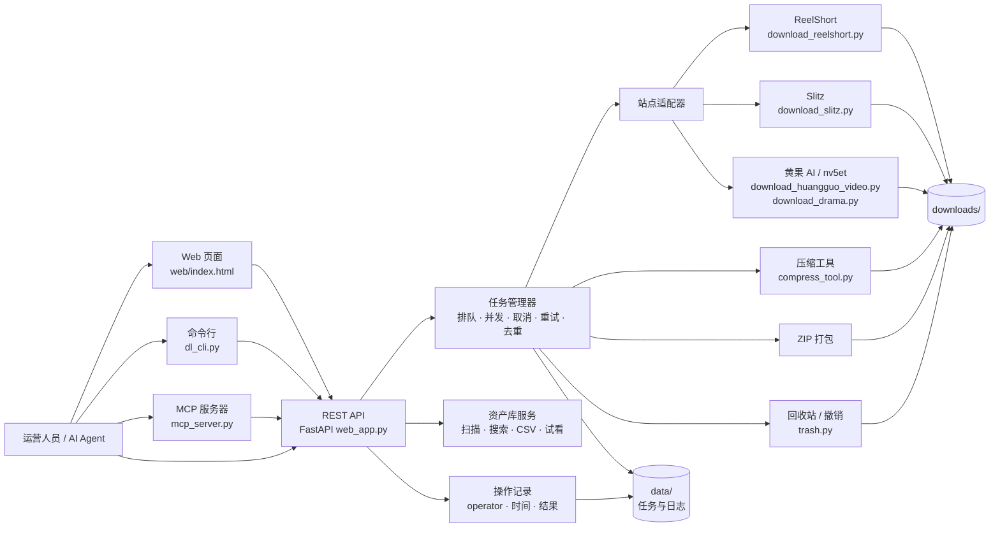
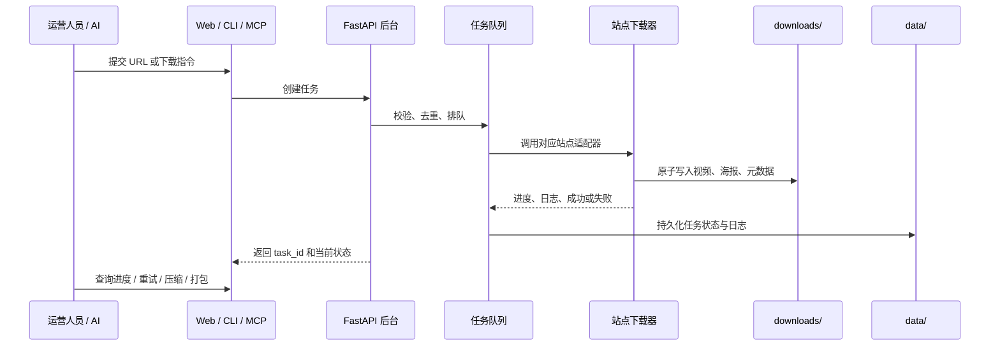

# 短剧下载平台 · 架构图

这份文档说明网页、命令行、MCP 和 REST API 如何共用同一个后台，以及下载、压缩、打包和回收站之间的关系。

## 总体架构

## 一次下载的处理流程

## 目录与职责

| 层 | 主要文件或目录 | 职责 |
| :--- | :--- | :--- |
| 交互层 | `web/index.html`、`dl_cli.py`、`mcp_server.py` | 接收同事或 AI 的操作 |
| 服务层 | `web_app.py`、`dl_client.py` | API、任务状态、权限和参数校验 |
| 下载层 | `download_reelshort.py`、`download_slitz.py`、`download_huangguo_video.py`、`download_drama.py` | 解析站点并生成视频资产 |
| 后处理层 | `compress_tool.py`、ZIP、`trash.py` | 压缩、归档、恢复和回收站 |
| 持久化层 | `downloads/`、`data/` | 视频资产、任务日志和操作记录 |

## 站点适配状态

站点页面结构和播放接口会变化。文档中的“支持”表示项目已经有对应适配器，不表示每个页面当前都一定提供可公开下载的播放地址。

| 站点 | 当前入口 | 说明 |
| :--- | :--- | :--- |
| ReelShort | `download_reelshort.py` | 支持最新剧、剧 ID 和断点续传；个别集数可能返回错误播放流 |
| Slitz | `download_slitz.py` | 支持 MP4 直链探测、批量下载和已存在文件跳过 |
| `huangguodrama.ai` | `download_drama.py` | 能解析到 `video` 数据的页面可下载；不同剧目可用性不同 |
| `nv5et.wrjmtnebd.cc` | `download_huangguo_video.py` | 支持 HLS 解密和 MP4 转封装；部分集数可能没有播放地址 |
| `huangguo.me` | `download_huangguo_video.py` | 当前页面结构可能不含 `videoInitialData`，遇到该错误需等待适配器更新 |

## 推荐使用顺序

1. 普通同事：打开 Web 页面。
2. AI Agent：先调用 `status`，再通过 CLI、MCP 或 REST 创建任务。
3. 站点脚本调试：直接运行对应的 `download_*.py`，确认解析到集数后再批量下载。
4. 下载完成后：在资产库确认集数，再执行压缩或 ZIP；删除和永久清理遵循 `AGENTS.md` 的安全约定。
